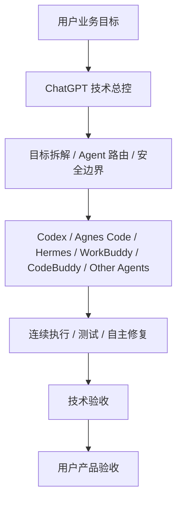
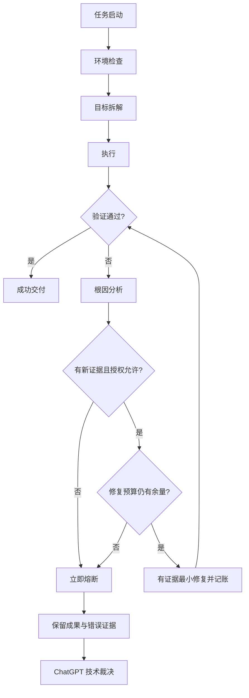

# Doraemon Goal-Driven Delivery

绿色 = 当前 CI 检查通过；红色 = 当前 CI 检查失败。CI 测试通过不代表真实 Agent 的端到端自主执行已经验证。

**V1.1 · 一次授权，连续执行，有证据验收，有边界熔断。**

[English](README_EN.md) · [完整规则](SKILL.md) · [安装](docs/INSTALLATION.md) · [架构](docs/ARCHITECTURE.md) · [流程](docs/WORKFLOW.md) · [安全](docs/SAFETY.md)

## 为什么创建

传统 Agent 容易把任务当成逐步问答：选工具、修一个 Bug、完成一个子步骤都重新询问用户。目标、授权、验收和停止条件不清晰时，用户被迫成为技术节点审批员；另一极端是反复重试，浪费时间与额度。

本 Skill 用一组可移植的协作规则，把工作单位变成完整可验收成果：在一次明确授权内连续完成实现、测试、定位、有限修复和复测。它是提示词层的执行协议，不是自动调度平台、运行时沙箱或无限自主执行系统。

## 谁负责什么

| 角色 | 责任 |
| --- | --- |
| 用户 | 业务目标、授权边界、产品与最终体验验收 |
| ChatGPT 技术总控 | 规划、任务拆解、Agent 路由、技术裁决、熔断后决策 |
| 执行 Agent | 环境核验、实施、测试、证据驱动修复、交付与保全 |

ChatGPT 与执行 Agent 的分工是协作约定；实际路由通过派工完成，仓库没有自动多 Agent 调度代码。普通技术问题由执行 Agent 自主处理；越权、生产安全、隐私、不可逆操作及新增费用仍须遵守权限与安全门禁。

## 协作架构

## 执行与熔断

同一根因最多 **2 轮有证据修复**，全任务默认最多 **4 轮有效修复**；更严格预算优先。每轮记录根因假设、证据、最小修改、验收方式。没有新证据立即熔断；不得通过拆分任务、改名或重启会话规避预算。禁止无限重试、自动购买额度、绕过生产安全门禁。额度不可读时写 `QUOTA=UNKNOWN`。熔断后停止相关修复，保留已通过成果及证据，输出 PARTIAL/BLOCKED，交总控裁决。[完整安全边界](docs/SAFETY.md)。

## 快速使用

1. 按 [Windows PowerShell 安装说明](docs/INSTALLATION.md) 定位实际宿主目录并安装；CodeBuddy 使用内嵌规则。
2. 在任务中显式请求加载本 Skill，提供目标、类型、范围、验收、授权和预算，见 [派工模板](examples/task-dispatch.md)。开发任务与 `doraemon-local-dev-guard` 叠加，后者需另行安装。
3. 让 Agent 连续完成任务；以真实测试、回读或渲染结果验收，见 [验收报告](examples/acceptance-report.md)。通过或熔断后停止，不自动进入下一阶段。

## 验证边界

| 项目 | 状态与证据 |
| --- | --- |
| V1.1 发布源 | Codex/Agnes Code/Hermes/WorkBuddy 四份本机安装文件 SHA-256 一致；发布 SKILL.md 原字节保留 |
| CodeBuddy 适配 | V1.1 内嵌规则已核对；原文关于宿主不支持原生安装的绝对断言改为 UNVERIFIED |
| 格式、安全条款、链接 | 可复现静态测试：`python -X utf8 -m unittest discover -s tests -v` |
| 熔断场景 | 测试用参考模型覆盖根因/全任务预算、无新证据、回归、越权和预算耗尽；不是运行时强制器 |
| 旧隔离测试 | 仅见 T1–T7 PASS 汇总及简单示例，缺少熔断测试源码和执行链；不作为行为 PASS 证据 |
| 宿主发现与加载 | 当前 Codex 会话明确提供本 Skill；Agnes Code/Hermes/WorkBuddy/CodeBuddy 自动发现与行为 E2E 均 UNVERIFIED |
| 实际模型遵循与自动拦截 | UNVERIFIED；提示词不能保证模型遵循，也不实施工具权限控制 |

本项目无运行时依赖；测试仅使用 Python 标准库。Mermaid 由 GitHub 原生渲染，见 [维护验证说明](docs/WORKFLOW.md)。MIT 授权只覆盖本仓库内容，不包含第三方 Agent、ChatGPT 或开发守卫的实现与商标。
